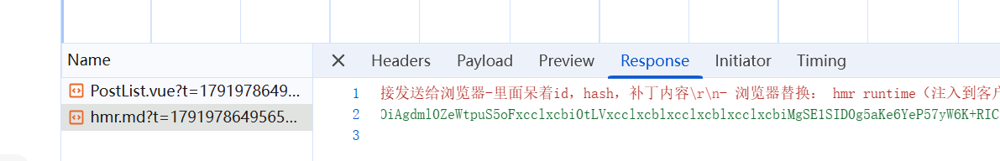

# HMR = 增量编译 + WebSocket 推送 + 运行时就地替换
- 构建监听：dev server用文件监听源码的变化
- 增量编译：只重新编译受影响的模块
- 推送： 通过websocket长连接发送给浏览器-里面呆着id，hash，补丁内容
- 浏览器替换： hmr runtime（注入到客户端的代码）收到消息，调用模块的hot。accept回调，新模块替换旧模块，并处罚dispose做清理。

# webpack 和 vite区别？
- webpack在dev也是要重新打包，项目越大依赖越深，hmr的速度就会变慢
- vite 开发态是esm，所以改一个文件只编译哪一个文件，ws通知浏览器，重新import modul的url即可，不管项目多大，hmr受影响较小。